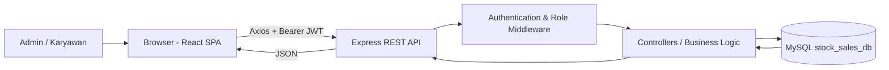
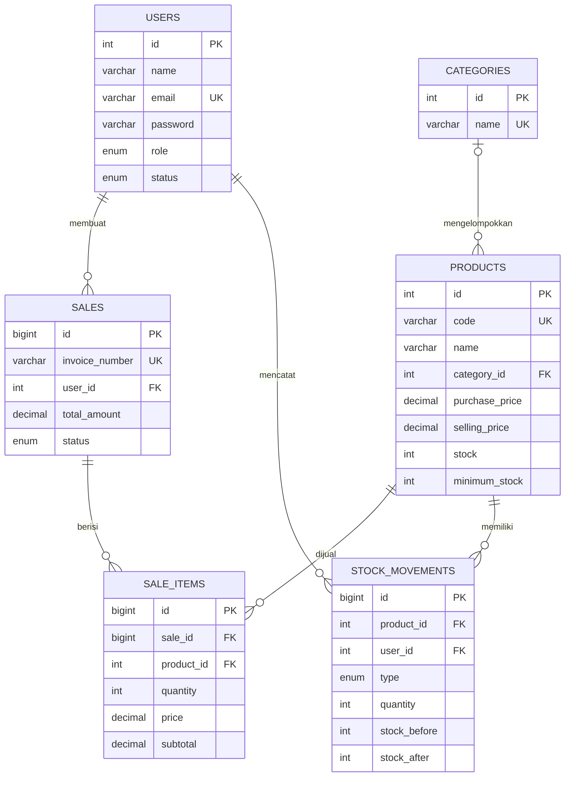

<a id="readme-top"></a>

<div align="center">

# 📦 SISTEM STOK PENJUALAN

### *VirtualStore — Inventory & Sales Management System*

**Aplikasi web full-stack untuk mengelola inventori, pergerakan stok, transaksi penjualan, dan laporan toko dalam satu sistem.**  
Dilengkapi dashboard berbasis peran **Admin** dan **Karyawan**, autentikasi JWT, serta tampilan responsif dengan identitas biru–putih.


-1D4ED8?style=for-the-badge&logo=nodedotjs&logoColor=white)


**Dokumentasi:** Bahasa Indonesia · **Status:** telah melalui QA lokal; deployment produksi belum tersertifikasi

[Ringkasan](#ringkasan) · [Fitur](#fitur-utama) · [Instalasi](#instalasi-lokal) · [API](#dokumentasi-api) · [Deployment](#deployment-github-dewacloud) · [Pengujian](#pengujian-quality-assurance)

</div>

---

## 📑 Daftar Isi

1. [Ringkasan](#ringkasan)
2. [Fitur Utama](#fitur-utama)
3. [Teknologi](#teknologi)
4. [Pratinjau Aplikasi](#pratinjau-aplikasi)
5. [Arsitektur Sistem](#arsitektur-sistem)
6. [Struktur Proyek](#struktur-proyek)
7. [Persyaratan](#persyaratan)
8. [Instalasi Lokal](#instalasi-lokal)
9. [Konfigurasi Environment](#konfigurasi-environment)
10. [Struktur Database](#struktur-database)
11. [Dokumentasi API](#dokumentasi-api)
12. [Autentikasi dan Hak Akses](#autentikasi-dan-hak-akses)
13. [Pengujian dan Quality Assurance](#pengujian-quality-assurance)
14. [Deployment GitHub ke DewaCloud](#deployment-github-dewacloud)
15. [Keamanan](#keamanan)
16. [Troubleshooting](#troubleshooting)
17. [Rencana Pengembangan](#rencana-pengembangan)
18. [Pengembang dan Kredit](#pengembang-dan-kredit)

---

<a id="ringkasan"></a>

## 🎯 Ringkasan

**Sistem Stok Penjualan** (VirtualStore) membantu toko mencatat produk, memantau stok, merekam transaksi, dan membaca laporan penjualan secara terpusat. Sistem menggunakan **React + Vite** sebagai frontend, **Express** sebagai REST API, dan **MySQL** untuk penyimpanan data relasional.

### Masalah yang ingin diselesaikan

- Pencatatan produk dan stok secara manual rentan terhadap selisih data.
- Riwayat barang masuk, barang keluar, dan penjualan sulit ditelusuri jika disimpan terpisah.
- Kebutuhan informasi penjualan berbeda antara pengelola dan karyawan.
- Data stok perlu dijaga tetap konsisten ketika transaksi mengurangi persediaan.

### Solusi dalam aplikasi

- Satu database untuk produk, kategori, pengguna, penjualan, dan histori stok.
- Perubahan stok dicatat dengan informasi sebelum/sesudah dan pengguna pelaksana.
- Checkout menghitung nominal menggunakan harga dari database dan mengurangi stok melalui transaksi MySQL.
- Hak akses **Admin** dan **Karyawan** diterapkan di frontend **dan** backend.

> **Catatan cakupan:** README ini disusun dari arsip source code `stock-penjualan(2).zip`, dump `stock_sales_db (1).sql`, dan laporan audit proyek tanggal **15 November 2026**. Dokumentasi ini tidak mengklaim bahwa lingkungan DewaCloud telah berhasil di-deploy atau telah diuji ulang pada saat README dibuat.

<a id="fitur-utama"></a>

## ✨ Fitur Utama

| Area | Admin | Karyawan |
| --- | --- | --- |
| Dashboard | Ringkasan produk, stok menipis, transaksi, dan karyawan | Dashboard khusus aktivitas karyawan |
| Produk | Melihat, mencari, memfilter, menambah, mengubah, menghapus | Melihat, mencari, dan memfilter produk |
| Kategori | Membaca kategori yang tersedia | Membaca kategori yang tersedia |
| Stok | Tambah/kurangi stok, lihat riwayat seluruh pengguna dan riwayat sendiri | Tambah/kurangi stok, lihat riwayat sendiri |
| Penjualan | Buat transaksi dan lihat seluruh transaksi | Buat transaksi dan lihat transaksi sendiri |
| Laporan | Ringkasan dan laporan penjualan menurut rentang tanggal | Tidak tersedia |
| Pengguna | Tambah, ubah, aktif/nonaktif, reset password, dan hapus | Tidak tersedia |
| Akun | Login, ubah profil sendiri, ubah password | Login, ubah profil sendiri, ubah password |

**Pengalaman antarmuka yang terlihat di source:** pencarian/filter produk, indikator stok minimum, notifikasi dan toast, modal pengisian form, grafik dashboard/laporan menggunakan Recharts, ekspor CSV untuk laporan, React Router, serta navigasi responsif desktop dan mobile.

**Batas fitur saat ini:** route kategori hanya menyediakan `GET` (bukan CRUD kategori); belum ditemukan pagination UI, pembatalan transaksi, maupun endpoint logout di server. Registrasi publik selalu membuat akun aktif berperan `karyawan`.

<a id="teknologi"></a>

## 🛠️ Teknologi

| Lapisan | Teknologi / library | Peran |
| --- | --- | --- |
| Frontend | React 19, React DOM, React Router 7 | Antarmuka SPA dan navigasi halaman |
| Build | Vite 8, `@vitejs/plugin-react` | Development server dan build frontend |
| Desain | Tailwind CSS 4, Lucide React | Styling responsif dan ikon |
| Data/UX | Axios, Sonner, Recharts | HTTP client, notifikasi, grafik |
| Backend | Node.js, Express 5 | REST API, middleware, static frontend produksi |
| Database | MySQL, `mysql2/promise` | Penyimpanan data, relasi, transaksi |
| Keamanan | JWT, bcryptjs, express-rate-limit, CORS, validasi kustom | Autentikasi, validasi, pembatasan request |
| Konfigurasi | dotenv | Environment variables |
| Pengujian | Node.js `node:test`, Oxlint | Pengujian otomatis dan pemeriksaan kode |

> Versi dependensi bersumber dari `backend/package.json` dan `frontend/package.json`. Lingkungan yang **tercatat berhasil diuji pada 15 November 2026**: Node.js 24.22.0, npm 11.19.1, Express 5.3.0, React 19.3.1, dan Vite 8.3.8. Gunakan versi Node.js yang kompatibel dengan dependency proyek; Node 24.22.0 adalah acuan yang telah diuji, bukan jaminan kompatibilitas semua versi.

<a id="pratinjau-aplikasi"></a>

## 🖼️ Pratinjau Aplikasi

Dua gambar berikut berasal dari artefak pengujian browser, bukan hasil desain ulang atau screenshot rekaan.

**Dashboard Admin — capture QA**


**Form Tambah Produk — viewport mobile (capture QA)**

<p align="center">
  
</p>

> Screenshot audit hanya menggambarkan kondisi saat pengujian dan dapat memperlihatkan data fixture. Galeri login, register, laporan, dan halaman lainnya dapat ditambahkan setelah screenshot aslinya tersedia. Folder `docs/screenshots/` disertakan agar referensi gambar tidak bergantung pada `.audit/` yang mungkin diabaikan Git.

<a id="arsitektur-sistem"></a>

## 🧩 Arsitektur Sistem



**Alur utama:**

1. Pengguna login melalui frontend; API mengembalikan JWT setelah validasi kredensial dan status akun.
2. Axios menambahkan header `Authorization: Bearer <token>` pada request saat token tersedia.
3. Middleware mengecek JWT, status dan role terkini di database.
4. Controller mengakses MySQL melalui `mysql2/promise`; operasi stok dan penjualan memakai transaksi untuk menjaga konsistensi.
5. Frontend menampilkan hasil dan menangani respons gagal, termasuk sesi tidak valid.

**Mode runtime:** saat development, Vite melayani frontend dan Express melayani API pada port terpisah. Saat `NODE_ENV=production`, Express menyajikan berkas statis hasil build `frontend/dist/` sekaligus API, dengan fallback route SPA untuk URL halaman yang bukan API.

<a id="struktur-proyek"></a>

## 🗂️ Struktur Proyek

```text
stock-penjualan/
├── README.md                         # Dokumentasi utama repository
├── PROJECT_AUDIT_REPORT.md           # Laporan audit lokal (15 Nov 2026)
├── docs/
│   └── screenshots/                  # Capture QA untuk README
│       ├── dashboard-audit.png
│       └── form-produk-mobile-audit.png
├── backend/
│   ├── server.js                      # Express, routes, CORS, rate limit, SPA fallback
│   ├── package.json                   # Dependensi dan scripts backend
│   ├── .env.example                   # Template variabel (lihat catatan CLIENT_URL)
│   ├── scripts/
│   │   ├── audit-browser.cjs          # Helper QA browser
│   │   └── audit-database.cjs         # Diagnostik database
│   ├── src/
│   │   ├── config/database.js         # Connection pool MySQL
│   │   ├── controllers/               # Logika autentikasi, CRUD, transaksi, laporan
│   │   ├── middleware/                # Authentication, authorization, validasi ID
│   │   ├── routes/                    # Definisi endpoint API
│   │   └── utils/                     # Validasi, JWT, pembuatan admin
│   └── test/api.test.cjs              # Tes HTTP dan MySQL
└── frontend/
    ├── index.html
    ├── vite.config.js
    ├── package.json
    ├── .env.example
    ├── .env.production.example
    ├── public/
    ├── src/
    │   ├── App.jsx                    # React Router + lazy-loaded pages
    │   ├── components/                # UI, navigasi, auth, header, modal
    │   ├── context/                   # AuthProvider
    │   ├── hooks/                     # Custom hook autentikasi
    │   ├── layouts/                   # Layout Admin dan Karyawan
    │   ├── pages/
    │   │   ├── admin/                 # Dashboard, produk, stok, sales, laporan, users
    │   │   ├── employee/              # Dashboard, produk, stok, sales
    │   │   └── auth/                  # Login dan Register
    │   ├── services/api.js            # Axios client dan interceptors
    │   └── utils/                     # Formatter, CSV, toast helpers
    └── test/utilities.test.js         # Tes utilitas frontend
```

`node_modules/`, `.env` asli, `.git/`, `frontend/dist/`, dan sumber tambahan tooling desain tidak ditampilkan karena bukan inti struktur source aplikasi. Dump SQL yang dilampirkan pengguna **terpisah dari ZIP source**, sehingga tidak diasumsikan sudah tersedia di repository GitHub.

<a id="persyaratan"></a>

## ✅ Persyaratan

- Windows 10/11, Linux, atau macOS; instruksi di bawah dicontohkan untuk **Windows**.
- **Node.js** dan npm kompatibel dengan Vite 8 / Express 5; lingkungan QA memakai **Node 24.22.0 + npm 11.19.1**.
- **MySQL 8.x** (SQL yang dilampirkan diekspor dari MySQL 8.0.46).
- **Git** dan terminal PowerShell / Git Bash.
- **Visual Studio Code** atau editor lain, dan browser modern.
- **XAMPP/phpMyAdmin** opsional untuk pengelolaan database; sesuaikan SQL dengan server MySQL yang digunakan (XAMPP tertentu memasang MariaDB, bukan MySQL 8).

<a id="instalasi-lokal"></a>

## 🚀 Instalasi Lokal

### 1. Clone repository

```bash
git clone https://github.com/OWNER/REPOSITORY.git
cd stock-penjualan
```

Ganti `OWNER/REPOSITORY` dengan alamat repository sebenarnya. Jika menggunakan ZIP, ekstrak lalu buka folder `stock-penjualan` di VS Code; tidak perlu menjalankan `git clone`.

### 2. Pasang dependencies

Jalankan dari folder **root** proyek:

```bash
cd backend
npm install
cd ../frontend
npm install
cd ..
```

Untuk instalasi yang mereproduksi versi di lockfile, gunakan `npm ci` sebagai pengganti `npm install` ketika lockfile tersedia dan cocok.

### 3. Siapkan database lokal

Dump pribadi `stock_sales_db (1).sql` yang disertakan terpisah membuat database `stock_sales_db` beserta enam tabel dan data demo. **Dump ini memuat data akun, hash password, dan riwayat transaksi: jangan commit file aslinya ke repository publik.**

Buka MySQL CLI / MySQL Workbench / phpMyAdmin, lalu import salinan lokal yang disimpan di luar repository. Contoh dari prompt MySQL (sesuaikan jalur Windows dan gunakan `/`):

```sql
SOURCE D:/backup-pribadi/stock_sales_db.sql;
```

Perintah ini harus dijalankan **di dalam klien MySQL**, bukan sebagai SQL query phpMyAdmin. Untuk phpMyAdmin, pilih menu **Import** dan unggah berkas SQL melalui antarmuka. Dump ini menggunakan `DROP TABLE IF EXISTS` sehingga **dapat menghapus tabel dengan nama sama beserta data lama**; buat backup dan pakai database khusus development sebelum import.

Jika tidak menggunakan dump demo, perlu menyiapkan schema yang kompatibel secara terpisah. Repository ZIP belum menyertakan script migration/schema mandiri. Jangan menjalankan aplikasi pada database kosong tanpa enam tabel yang diperlukan.

### 4. Konfigurasi backend

Masuk ke `backend/`, lalu salin `.env.example` menjadi `.env` dan sesuaikan nilainya (contoh PowerShell):

```powershell
cd backend
Copy-Item .env.example .env
```

Gunakan contoh variabel [di bawah](#konfigurasi-environment); khususnya, tambahkan `CLIENT_URL=http://localhost:5173` dan ubah `NODE_ENV=development` saat development. Jangan menggunakan secret contoh pada deployment publik.

### 5. Konfigurasi frontend

Dari `backend/`:

```powershell
cd ../frontend
Copy-Item .env.example .env
```

Pastikan frontend menggunakan:

```dotenv
VITE_API_BASE_URL=http://localhost:3000/api
VITE_APP_NAME=Sistem Stok Penjualan
```

### 6. Jalankan backend dan frontend

**Terminal pertama:**

```bash
cd backend
npm run dev
```

**Terminal kedua:**

```bash
cd frontend
npm run dev
```

Alamat default:

| Layanan | Alamat |
| --- | --- |
| Frontend Vite | `http://localhost:5173` |
| Backend API | `http://localhost:3000` |
| API health check | `http://localhost:3000/api/health` |

### 7. Buat akun dan masuk

Halaman **Register** membuat akun dengan role `karyawan`. Untuk akun `admin` pada database yang belum memiliki admin, isi variabel `ADMIN_NAME`, `ADMIN_EMAIL`, `ADMIN_PASSWORD` di **`backend/.env`** dan jalankan dari **direktori backend**:

```bash
npm run create-admin
```

`create-admin` mengecek apakah email sudah ada dan menyimpan hash password menggunakan bcrypt. **Jangan memakai kredensial contoh/dump publik sebagai akun nyata.** Setelah itu, buka `http://localhost:5173/login`.

### 8. Verifikasi

```bash
curl http://localhost:3000/api/health
```

Jika berhasil, API mengembalikan JSON dengan `success: true`, `server: "running"`, dan `database: "connected"`. Ini hanya memverifikasi server + koneksi database saat diperiksa, bukan seluruh alur bisnis.

<a id="konfigurasi-environment"></a>

## ⚙️ Konfigurasi Environment

### Backend — `backend/.env`

Contoh **development** (nilai contoh, bukan konfigurasi nyata):

```dotenv
NODE_ENV=development
PORT=3000

DB_HOST=127.0.0.1
DB_PORT=3306
DB_USER=your_local_mysql_user
DB_PASSWORD=your_local_mysql_password
DB_NAME=stock_sales_db

JWT_SECRET=replace-with-your-own-long-random-secret-at-least-32-chars
JWT_EXPIRES_IN=8h

CLIENT_URL=http://localhost:5173
APP_NAME=Sistem Stok Penjualan

# Opsional jika menjalankan npm run create-admin
# ADMIN_NAME=Administrator
# ADMIN_EMAIL=admin@example.test
# ADMIN_PASSWORD=choose-a-unique-strong-password
```

| Variabel | Fungsi |
| --- | --- |
| `NODE_ENV` | `development` = API terpisah; `production` = API + frontend build |
| `PORT` | Port Express (default 3000) |
| `DB_HOST`, `DB_PORT` | Lokasi dan port database |
| `DB_USER`, `DB_PASSWORD`, `DB_NAME` | Identitas koneksi MySQL |
| `JWT_SECRET`, `JWT_EXPIRES_IN` | Secret dan masa aktif JWT |
| `CLIENT_URL` | Origin frontend yang diizinkan oleh middleware CORS |
| `ADMIN_NAME`, `ADMIN_EMAIL`, `ADMIN_PASSWORD` | Hanya digunakan saat menjalankan script `create-admin` |

**Penting — ketidaksesuaian template:** `backend/.env.example` dalam source mencantumkan `CORS_ORIGINS`, tetapi `backend/server.js` membaca **`CLIENT_URL`** (tidak membaca `CORS_ORIGINS`). Pastikan `CLIENT_URL` diisi. Pada `NODE_ENV=production`, server menolak startup jika `CLIENT_URL` kosong atau `JWT_SECRET` terlalu pendek/berupa placeholder; JWT secret minimal **32 karakter** dan harus acak. Variabel `APP_NAME` tercantum di template, tetapi tidak terlihat digunakan langsung oleh `server.js`.

### Frontend — `frontend/.env`

```dotenv
VITE_API_BASE_URL=http://localhost:3000/api
VITE_APP_NAME=Sistem Stok Penjualan
```

Untuk satu domain pada produksi, file `frontend/.env.production.example` menyarankan `VITE_API_BASE_URL=/api`. Karena nilai `VITE_` dibundel saat build, jangan memasukkan password, token, atau secret ke variabel frontend. Ulangi build setelah mengubah konfigurasi frontend produksi.

<a id="struktur-database"></a>

## 🗄️ Struktur Database

**Database:** `stock_sales_db` · **Engine:** InnoDB · **Collation:** `utf8mb4_unicode_ci`

| Tabel | Primary key | Fungsi / relasi |
| --- | --- | --- |
| `users` | `id` | Nama, email unik, hash password, role (`admin`/`karyawan`), status |
| `categories` | `id` | Kategori produk, nama unik |
| `products` | `id` | Kode unik, nama, kategori, harga beli/jual, stok, stok minimum |
| `sales` | `id` | Nomor invoice unik, kasir (`user_id`), total, status |
| `sale_items` | `id` | Item produk pada transaksi, jumlah, harga saat dijual, subtotal |
| `stock_movements` | `id` | Riwayat stok dengan produk, pengguna, jenis, sebelum/sesudah, catatan |



**Aturan relasional penting:** produk boleh kehilangan kategori ketika kategori dihapus (`products.category_id` dapat `NULL`); relasi transaksi dan histori stok menggunakan foreign key sehingga penghapusan referensi tertentu dibatasi; menghapus `sales` akan menghapus `sale_items` yang terkait pada level foreign key. Walaupun enum `sales.status` memuat `cancelled` dan `stock_movements.type` memuat `adjustment`, **tidak berarti aplikasi menyediakan endpoint pembatalan atau adjustment**. Route stok yang tersedia hanya menerima `in` dan `out`.

<a id="dokumentasi-api"></a>

## 🌐 Dokumentasi API

**Base URL development:** `http://localhost:3000/api`  
**Autentikasi:** untuk endpoint bertanda `JWT`, kirim `Authorization: Bearer <token>`.  
**Role:** `A` = Admin, `K` = Karyawan, `Publik` = tanpa token, `A/K` = kedua role.

### Authentication

| Method | Endpoint | Akses | Keterangan |
| --- | --- | --- | --- |
| `POST` | `/auth/register` | Publik | Registrasi akun `karyawan` |
| `POST` | `/auth/login` | Publik | Login; mengembalikan JWT |
| `GET` | `/auth/me` | JWT A/K | Detail pengguna saat ini |
| `PATCH` | `/auth/profile` | JWT A/K | Ubah nama/email sendiri |
| `PATCH` | `/auth/change-password` | JWT A/K | Ubah password sendiri |

### Products dan Categories

| Method | Endpoint | Akses | Keterangan |
| --- | --- | --- | --- |
| `GET` | `/products` | JWT A/K | Daftar produk, `search`, `category`, `stock_status` |
| `GET` | `/products/:id` | JWT A/K | Detail produk |
| `POST` | `/products` | JWT A | Tambah produk |
| `PUT` | `/products/:id` | JWT A | Ubah produk |
| `DELETE` | `/products/:id` | JWT A | Hapus produk |
| `GET` | `/categories` | JWT A/K | Daftar kategori |

### Stock dan Sales

| Method | Endpoint | Akses | Keterangan |
| --- | --- | --- | --- |
| `GET` | `/stock/history` | JWT A | Seluruh histori pergerakan stok; dapat difilter |
| `GET` | `/stock/my-history` | JWT A/K | Histori stok milik pengguna saat ini |
| `POST` | `/stock/update` | JWT A/K | Tambah/kurangi stok (`in`/`out`) |
| `GET` | `/sales` | JWT A/K | Semua transaksi untuk admin; transaksi sendiri untuk karyawan |
| `GET` | `/sales/my` | JWT K | Daftar transaksi karyawan yang login |
| `GET` | `/sales/my/:id` | JWT K | Detail transaksi milik karyawan |
| `GET` | `/sales/:id` | JWT A/K | Detail transaksi (kepemilikan diperiksa) |
| `POST` | `/sales` | JWT A/K | Buat transaksi penjualan |

### Dashboard, Reports, Users, dan Health

| Method | Endpoint | Akses | Keterangan |
| --- | --- | --- | --- |
| `GET` | `/dashboard/admin` | JWT A | Statistik dashboard Admin |
| `GET` | `/dashboard/employee` | JWT K | Statistik dashboard Karyawan |
| `GET` | `/reports/sales` | JWT A | Laporan penjualan; `start_date`, `end_date` (`YYYY-MM-DD`) |
| `GET` | `/users` | JWT A | Daftar pengguna |
| `POST` | `/users` | JWT A | Buat pengguna |
| `PUT` | `/users/:id` | JWT A | Ubah pengguna |
| `PATCH` | `/users/:id/status` | JWT A | Aktif/nonaktif pengguna |
| `PATCH` | `/users/:id/reset-password` | JWT A | Reset password pengguna |
| `DELETE` | `/users/:id` | JWT A | Hapus pengguna |
| `GET` | `/health` | Publik | Status server dan koneksi MySQL |

**Contoh request** (isi nilai contoh dengan data pengujian Anda):

```bash
# Login
curl -X POST http://localhost:3000/api/auth/login \
  -H "Content-Type: application/json" \
  -d '{"email":"user@example.test","password":"YOUR_PASSWORD"}'

# Ambil produk (ganti token hasil login)
curl http://localhost:3000/api/products \
  -H "Authorization: Bearer YOUR_JWT_TOKEN"

# Tambah stok (role admin/karyawan)
curl -X POST http://localhost:3000/api/stock/update \
  -H "Authorization: Bearer YOUR_JWT_TOKEN" \
  -H "Content-Type: application/json" \
  -d '{"product_id":1,"type":"in","quantity":5,"notes":"Restock contoh"}'

# Buat penjualan (harga ditentukan server dari database)
curl -X POST http://localhost:3000/api/sales \
  -H "Authorization: Bearer YOUR_JWT_TOKEN" \
  -H "Content-Type: application/json" \
  -d '{"items":[{"product_id":1,"quantity":2}]}'
```

Perintah `curl` multiline di atas menggunakan **Git Bash** (`\` sebagai line continuation). Pada PowerShell, gunakan satu baris atau `Invoke-RestMethod`; `curl` dapat berupa alias tergantung versi PowerShell. Semua contoh API harus dijalankan terhadap data development, bukan database produksi.

Contoh respons login yang mengikuti controller (nilai disamarkan):

```json
{
  "success": true,
  "message": "Login berhasil",
  "token": "<JWT_TOKEN>",
  "user": {
    "id": 1,
    "name": "Pengguna Demo",
    "email": "user@example.test",
    "role": "karyawan",
    "status": "active"
  }
}
```

**Catatan:** respons dan status HTTP kegagalan bergantung pada validasi dan kondisi database; contoh bukan bukti request telah dieksekusi saat pembuatan README.

<a id="autentikasi-dan-hak-akses"></a>

## 🔐 Autentikasi dan Hak Akses

- Password disimpan menggunakan **bcrypt**; login memvalidasi email, password, dan status akun.
- JWT menggunakan algoritma **HS256** dan masa kedaluwarsa dari `JWT_EXPIRES_IN` (fallback kode: `1d`).
- Middleware `authenticateToken` memeriksa JWT **serta** status/role pengguna yang terkini di database.
- Middleware `authorizeRole` melarang endpoint yang tidak sesuai peran (`403`).
- Token tidak berlaku setelah perubahan password dan perubahan data akun yang relevan, sesuai pemeriksaan versi kredensial/timestamp di middleware.
- Karyawan hanya dapat melihat histori penjualan yang menjadi miliknya; API melakukan pemeriksaan kepemilikan.
- Frontend menyimpan JWT di `localStorage` dan menghapusnya pada logout atau `401` tertentu. **Logout saat ini bersifat client-side**, tanpa endpoint pencabutan token di server.
- **Registrasi publik** langsung membuat akun aktif berrole `karyawan`. Tinjau keputusan ini sebelum membuka aplikasi ke internet.

<a id="pengujian-quality-assurance"></a>

## 🧪 Pengujian & Quality Assurance

Script yang benar-benar ada di source:

```bash
# Jalankan dari root proyek
cd backend
npm test                    # node --test test/*.test.cjs
npm run test:db             # diagnostik read-only schema dan konsistensi data
cd ../frontend
npm test                    # node --test test/*.test.js
npm run lint                # Oxlint
npm run build               # Vite production build
npm run preview             # pratinjau build frontend saja
```

**Catatan keselamatan:** test backend menggunakan MySQL nyata dengan transaksi fixture yang di-rollback. Script QA menolak `NODE_ENV=production`, tetapi tetap harus dijalankan pada database development/staging yang dapat dipulihkan; jangan jalankan test integrasi pada database bisnis aktif. Jalankan helper audit browser dan pengujian API **secara bergiliran**.

### Hasil audit historis — 15 November 2026

| Pemeriksaan | Hasil terdokumentasi |
| --- | --- |
| Backend integration tests | **67 lulus / 67** |
| Frontend utility tests | **10 lulus / 10** |
| Frontend build | **Lulus** |
| Frontend Oxlint | **0 error, 13 warning** |
| API health check lokal | **HTTP 200**, database terhubung |
| Smoke browser | Admin 6 halaman × 3 viewport; karyawan 4 halaman × 3 viewport (Chromium) |
| `npm audit` frontend | 0 vulnerability saat audit |
| `npm audit` backend production-only | 0 vulnerability saat audit |
| `npm audit` backend termasuk dev | 2 laporan moderate terkait rantai dependency Nodemon/Minimatch |

Pengujian **belum** mengonfirmasi beban multi-kasir, unduhan CSV fisik, hasil print OS, semua browser/perangkat, ataupun deployment HTTPS/DewaCloud. Status audit: **layak masuk staging terkontrol; belum tersertifikasi siap produksi**. Seluruh rincian, keterbatasan, dan evidence tersedia di [`PROJECT_AUDIT_REPORT.md`](PROJECT_AUDIT_REPORT.md).

<a id="deployment-github-dewacloud"></a>

## ☁️ Deployment GitHub → DewaCloud

> Bagian ini adalah **panduan konfigurasi umum berdasarkan source**. Fitur panel dan perintah spesifik DewaCloud Trial perlu disesuaikan dengan paket/lingkungan hosting Anda; tidak ada klaim deployment live.

### 1. Persiapan repository dan keamanan

- Commit frontend, backend, `README.md`, serta screenshot dokumentasi yang aman.
- Pastikan `.env`, credential, dump SQL pribadi, `node_modules/`, dan log sensitif **tidak ikut ter-commit**, termasuk pada riwayat Git.
- Siapkan database MySQL hosting dan schema/seed yang **telah disanitasi**. Jangan restore dump berisi data akun pengguna nyata ke server publik.
- Tentukan domain HTTPS final untuk frontend/backend serta konfigurasi reverse proxy bila diperlukan.

### 2. Build frontend

```bash
cd frontend
npm ci
npm run build
```

Build menghasilkan `frontend/dist/`. Pada source saat ini, `backend/server.js` membaca folder tersebut relatif ke backend (`../frontend/dist`) saat `NODE_ENV=production`. Jika hosting hanya menyalin folder `backend`, file frontend **tidak akan ikut tersaji** tanpa penyesuaian struktur deployment.

### 3. Konfigurasi server produksi

Atur environment pada hosting tanpa memasukkannya ke repository:

```dotenv
NODE_ENV=production
PORT=3000
DB_HOST=production-db-host
DB_PORT=3306
DB_USER=production-db-user
DB_PASSWORD=your-private-secret
DB_NAME=stock_sales_db
JWT_SECRET=generate-a-new-random-secret-of-32-or-more-characters
JWT_EXPIRES_IN=8h
CLIENT_URL=https://your-domain.example
```

Ganti seluruh placeholder **sebelum menjalankan server**. `JWT_SECRET` contoh di atas bukan secret yang aman untuk digunakan apa adanya. Frontend production dapat dibuild dengan `VITE_API_BASE_URL=/api` jika API dan UI tersedia dari domain yang sama.

### 4. Jalankan backend

```bash
cd backend
npm ci --omit=dev
npm start
```

Perintah aplikasi Node.js adalah **`node server.js`** dengan working directory dan struktur file yang tepat. Konfigurasi startup, proses persisten, reverse proxy, TLS, dan akses MySQL mengikuti kemampuan akun DewaCloud Anda.

### 5. Verifikasi hasil deployment

- Akses URL HTTPS aplikasi dan halaman `/login`.
- Panggil `https://your-domain.example/api/health` dan pastikan koneksi database.
- Uji login dengan akun pengujian yang baru dibuat, pemisahan role, CRUD produk, perubahan stok, dan checkout pada database staging.
- Refresh URL seperti `/admin/products` untuk menguji fallback SPA.
- Uji koneksi API dari browser dan periksa CORS serta HTTP status.
- **Jangan** menganggap berhasil hanya karena halaman awal dimuat; verifikasi data dan izin akses.

<a id="keamanan"></a>

## 🛡️ Keamanan

### Diterapkan pada source saat ini

- Password di-hash dengan bcrypt; verifikasi JWT + role/status dari database.
- Query parameterized melalui `mysql2`, validasi ID dan input di middleware/controller.
- Rate limiting pada `/api/auth` dengan **memory store per proses**.
- Pembatasan origin CORS berdasarkan `CLIENT_URL` serta daftar localhost saat development.
- Proses stok dan penjualan memakai transaksi dan row-level locking pada operasi relevan.
- Respons error terstruktur, header `x-powered-by` dinonaktifkan, dan penanganan JSON tidak valid.
- Utilitas ekspor CSV melakukan escaping dan mitigasi awalan formula spreadsheet.

### Harus ditinjau sebelum produksi

- **Registrasi publik:** akun karyawan aktif otomatis; pertimbangkan approval/undangan bila sesuai kebutuhan organisasi.
- **JWT di `localStorage`:** pertimbangkan CSP, penyimpanan cookie `HttpOnly` bila arsitektur diubah, dan revocation server untuk kebijakan sesi yang lebih ketat.
- **TLS:** wajibkan HTTPS dan konfigurasikan proxy/host produksi dengan benar.
- **Rate limiting:** jika aplikasi berskala multi-proses, pertimbangkan store bersama, bukan memori lokal.
- **Operasional:** backup terenkripsi, pemisahan hak akses database, monitoring, audit dependensi, serta uji beban/idempotency.
- **Privasi repository:** jangan pernah mengunggah `backend/.env`, `frontend/.env`, dump SQL pribadi, daftar email pengguna, password, hash password, atau JWT aktif. Jika pernah ter-commit, hapus dari history dan rotasi secret terkait.

<a id="troubleshooting"></a>

## 🔧 Troubleshooting

| Masalah | Penyebab umum | Langkah pemeriksaan |
| --- | --- | --- |
| Backend berhenti saat startup | `DB_*`/`JWT_SECRET` tidak lengkap, DB mati | Periksa `backend/.env`; uji login MySQL dan `npm run test:db` pada development |
| `Database connection failed` | Host, port, privilege, atau schema salah | Cocokkan `DB_HOST`, `DB_PORT`, `DB_USER`, `DB_PASSWORD`, `DB_NAME` |
| Login gagal (`401`/`403`) | Kredensial salah atau akun inactive | Cek role/status, request body, dan akun pengujian tanpa membocorkan password |
| Frontend tidak bisa akses API | Backend mati atau URL Vite salah | Periksa `/api/health`, `VITE_API_BASE_URL`, tab Network browser |
| Error CORS (`403`) | Origin frontend tidak diizinkan | Atur **`CLIENT_URL`** yang dibaca server; default dev localhost hanya port 5173 |
| Vite pindah ke port 5174 | Port 5173 sudah dipakai | Hentikan proses lama atau sesuaikan origin CORS secara aman |
| `401` saat sesi berjalan | JWT expired/invalid, akun dinonaktifkan, atau data akun berubah | Login ulang; periksa respons autentikasi |
| `EADDRINUSE` | Port 3000/5173 digunakan proses lain | Hentikan proses terkait atau pilih port yang tersedia, perbarui konfigurasi |
| Produk/penjualan error `400` | Format ID, jumlah, harga, atau payload salah | Sesuaikan dengan contoh API dan validasi controller |
| Stok tidak mencukupi saat penjualan | Jumlah melebihi persediaan | Periksa produk, stok terkini, dan histori pergerakan |
| `npm run build` gagal | Dependency/Node version atau source error | Gunakan Node yang kompatibel, `npm ci`, lalu baca error build |
| Refresh `/admin/...` menghasilkan 404 | Frontend SPA fallback tidak dikonfigurasi pada host | Pastikan build ada di `frontend/dist` dan Express production routing digunakan |
| Halaman produksi kosong/tidak memuat JS | Asset `dist` tidak tersaji atau base path keliru | Periksa Network browser dan struktur deployment |
| MySQL import gagal | Versi DB berbeda / schema sudah ada | Uji pada database kosong di staging, backup terlebih dahulu, tinjau SQL dan versi server |
| `npm test` menyentuh DB yang salah | Tes backend memakai MySQL nyata | Gunakan **database development/staging** dan pastikan `NODE_ENV` bukan production |

<a id="rencana-pengembangan"></a>

## 🧭 Rencana Pengembangan

Berikut adalah **rekomendasi**, bukan fitur yang telah tersedia:

- Migration dan schema-only seed aman untuk instalasi dari database kosong.
- Pagination/filter server-side untuk dataset besar serta optimasi query laporan.
- Pengujian concurrency multi-kasir dan mekanisme idempotency request penjualan.
- Kontrol registrasi/persetujuan akun untuk lingkungan internet publik.
- Monitoring, backup terjadwal, dan pipeline CI/CD terukur.
- Pengujian unduhan CSV, cetak invoice, Safari/Firefox, perangkat fisik, dan aksesibilitas lebih luas.
- Penyempurnaan manajemen sesi, kebijakan keamanan browser, serta perluasan suite test UI end-to-end.

<a id="pengembang-dan-kredit"></a>

## 👨‍💻 Pengembang dan Kredit

**Pengembang:** Saravanan  
**Proyek:** Sistem Stok Penjualan / VirtualStore  
**Jenis:** Aplikasi web full-stack manajemen inventori dan penjualan  
**Dokumentasi:** disusun berdasarkan source code serta artefak audit lokal.

**Repository GitHub:** *Tambahkan URL repository yang benar setelah dipublikasikan.*  
**Lisensi repository:** *Belum dapat dipastikan dari root repository; deklarasikan lisensi sebelum distribusi publik bila diperlukan.* (Field `ISC` pada `backend/package.json` bukan bukti adanya berkas lisensi root.)

Terima kasih kepada pengembang dan ekosistem open-source dari React, Vite, Tailwind CSS, Node.js, Express, MySQL, dan library pendukung yang digunakan.

---

<div align="center">

**SISTEM STOK PENJUALAN**  
*Kelola inventori lebih terstruktur · Catat transaksi lebih konsisten · Pantau aktivitas lebih jelas*

[↑ Kembali ke atas](#readme-top)

Jika proyek ini bermanfaat, pertimbangkan memberikan ⭐ **Star** pada repository GitHub setelah dipublikasikan.

</div>
